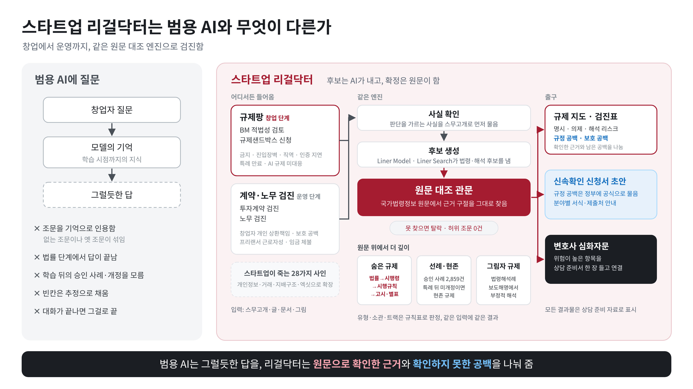
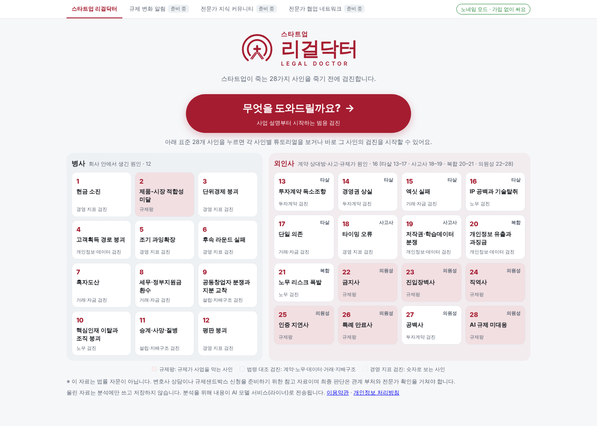
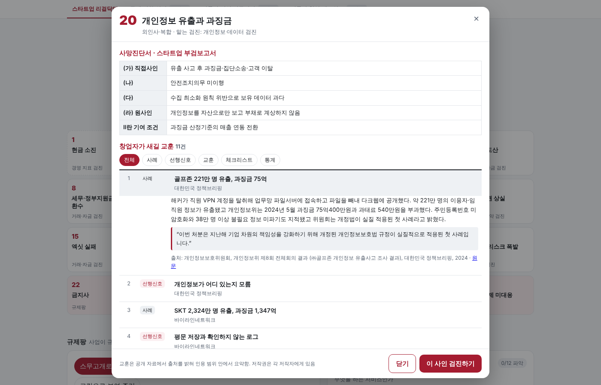
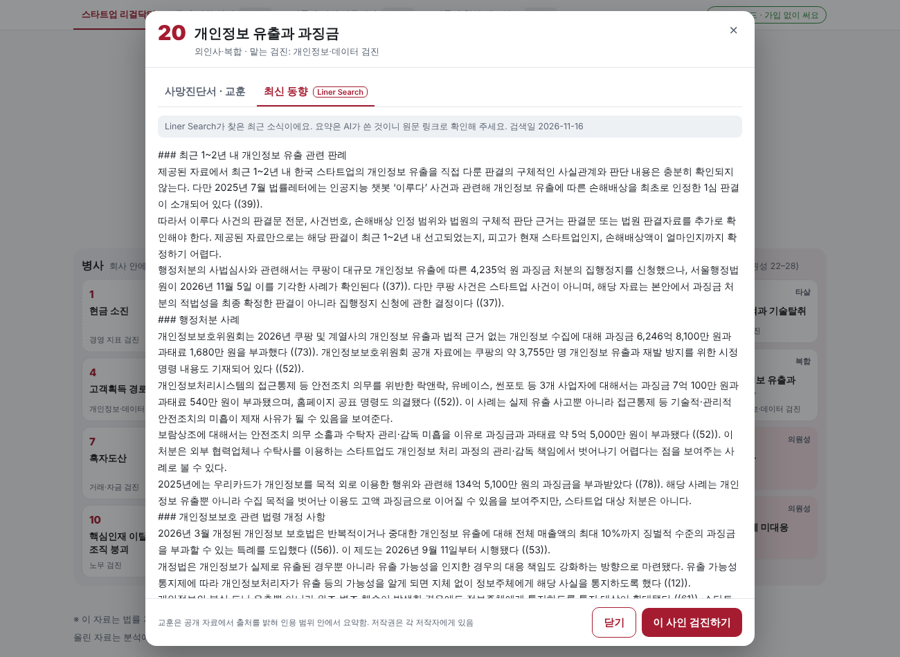
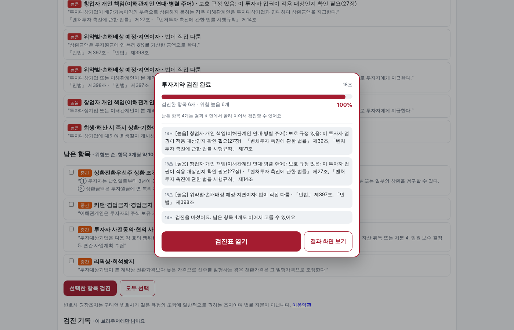
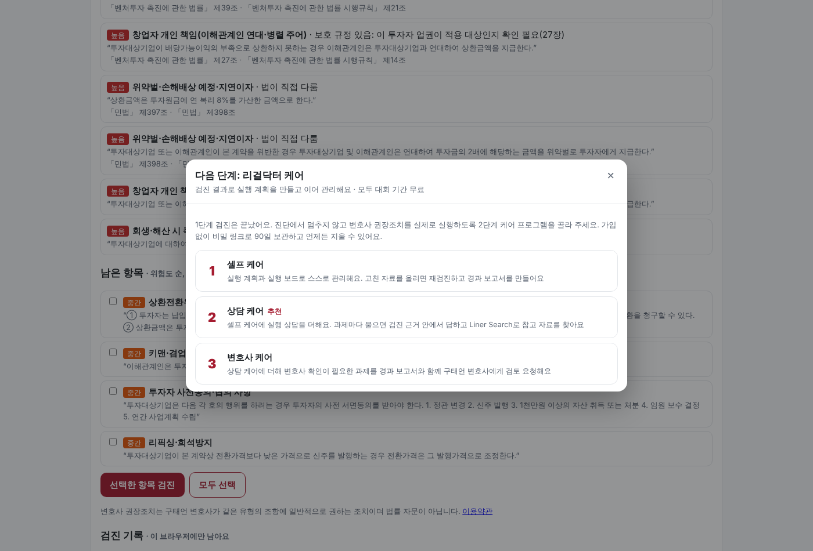
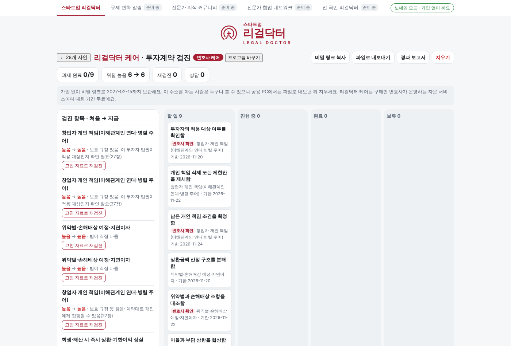
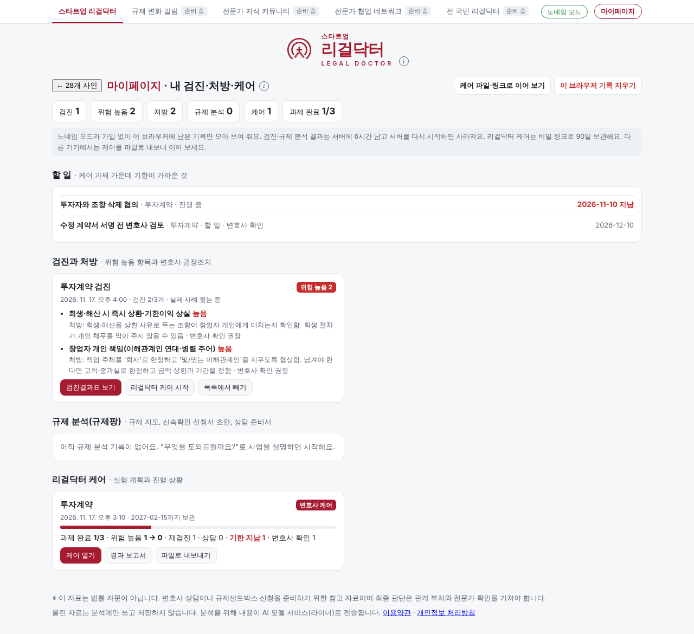

# 스타트업 리걸닥터 (Startup Legal Doctor)

스타트업이 죽는 28가지 사인을 죽기 전에 검진합니다.

법을 잘 모르는 창업자가 변호사를 찾기 전에 무료로 써 보는 규제·법률 사전상담 에이전트입니다. 라이너 .EXE-THON 2026 출품작입니다.



| 메뉴 | 대비하는 사인 | 상태 |
|---|---|---|
| **규제팡** · 막힌 규제, 팡! 뚫어 드려요 | 규제가 사업을 막는 외인성 사인(금지, 진입장벽, 직역, 인증 지연, 특례 만료, AI 규제 미대응). 창업 단계 BM 적법성 검토와 규제샌드박스 신청 | 구현 |
| **계약·노무 검진** | 투자계약(개인 상환책임, 경영권, 보호 공백), 노무(노무 리스크, 인재 이탈, IP 공백), 개인정보·데이터(유출·과징금, 학습데이터, 고객획득 경로), 거래·자금(흑자도산, 세무·지원금 환수, 엑싯 진술보장, 단일 의존), 설립·지배구조(공동창업자 지분, 승계) | 구현 |
| **경영 지표 검진** | 현금 소진, 단위경제, 조기 과잉확장, 후속 라운드, 평판, 타이밍. 법령 대조 없이 자료의 숫자로 런웨이·LTV/CAC 등을 계산함 | 구현 |

항목마다 15년 창업 법률 현장의 판단 순서로 원문을 대조하고 "변호사 권장조치"를 붙입니다. 깊은 검토가 필요하면 상담 준비서를 들고 이용자가 고른 변호사에게 가면 됩니다.

> 모든 결과물은 법률 자문이 아닙니다. 변호사 상담과 규제샌드박스 신청을 준비하는 참고 자료입니다.

## 심사 기준별로 보기

| 심사 기준 | 리걸닥터가 답하는 것 | 볼 곳 |
|---|---|---|
| 문제 정의 (30%) | 신생기업 5년 생존율 36.5%(10곳 중 6곳 이상 5년 안에 폐업). 창업자는 무엇을 물어야 할지 모른다. 변호사 첫 답까지 1주, 비용 100만~1,000만 원. 샌드박스 사례 2,859건 가운데 신속확인 개별 사례 0건 | [왜 만드나](#왜-만드나), 기획서 1장 |
| 완성도 (30%) | 28개 사인 모두 검진. 웹에서 바로 동작(사인 고르기 → 튜토리얼 또는 검진 → 결과표 인쇄·PDF·DOC → 리걸닥터 케어로 실행 관리). 공개 승인 사례 100건 평가에서 허위 조문 0건. 테스트 128건, Python 3.11·3.13 CI | [평가](#평가), [화면](#화면), `tests/` |
| Liner API 활용 (20%) | Liner Model은 사업 이해부터 조문 판정까지 모든 판단을 맡고, Liner Search는 규제 단서, 사인별 최신 동향, 검진 항목별 실제 판례·처분 사례를 찾음. 둘 다 후보만 내고 확정은 법령 원문 대조가 함 | [Liner API 사용 기능](#liner-api-사용-기능) |
| 확장성·임팩트 (20%) | 같은 엔진으로 액셀러레이터·VC 포트폴리오 검진, 법무팀 출시 전 검토, 샌드박스 사무국 접수 지원. 소상공인·외국인 노동자·육아맘 리걸닥터를 거쳐 모두의 리걸닥터로 | 기획서 6장, [기존 부분과 신규 부분](#기존-부분과-신규-부분) |

## 화면

| 첫 화면: 28개 사인(병사·외인사) | 사인 튜토리얼: 사망진단서와 교훈 331건 |
|---|---|
|  |  |
| **최신 동향: Liner Search** | **검진 완료 창** |
|  |  |

검진결과표는 우상단에서 인쇄, PDF, DOC로 받을 수 있습니다([예시 화면](docs/screens/05_result_tools.png)). 첫 화면에서 '무엇을 도와드릴까요?'를 누르면 사업 설명부터 시작하는 범용 검진으로 갑니다. 가입 없이 쓰고, 공용 PC에서는 다른 사인으로 넘어갈 때 입력 내용과 결과를 바로 지울 수 있습니다.

## 빠른 실행

Python 3.11 이상과 [uv](https://docs.astral.sh/uv/)가 필요합니다.

```bash
cp .env.example .env              # LINER_API_KEY를 채운다(LAW_OC는 선택)
uv run legaldoctor doctor         # Liner Model·Search·국가법령정보 연결 점검
uv run legaldoctor web            # 웹 화면 http://127.0.0.1:8000
```

uv가 없으면 `python3 -m venv .venv && . .venv/bin/activate && pip install -e .` 뒤에 `legaldoctor web`으로 실행합니다.

## 왜 만드나

**신생기업 10곳 중 6곳 이상이 5년 안에 문을 닫습니다.** 국가데이터처 2025년 기업생멸행정통계(2026.10.23)에서 신생기업 5년 생존율은 36.5%였고, 중소벤처기업부 자료로 본 창업기업 5년 생존율은 OECD 평균보다 11.6%p 낮습니다(33.8% 대 45.4%, 2020년 기준, 28개국 중 26위). 폐업 사유는 대개 "자금 소진"으로 적히지만 그것은 사망 시각일 뿐이고, 그 앞에 규제·계약·노무 같은 법률 사인이 있는 경우가 많습니다.

창업할 때는 숨은 규제가, 운영할 때는 계약과 노무가 회사를 죽입니다.

- 규제는 법률 본문보다 시행령, 시행규칙, 고시와 그 별표에 숨어 있고, 정부가 기존 조문을 새로 해석해 사업을 막기도 합니다.
- 규제샌드박스에는 규제가 있는지 정부에 묻는 신속확인 제도가 있지만, 공개된 샌드박스 사례 2,859건 가운데 신속확인 개별 사례는 한 건도 없습니다. 창업자는 참고할 선례 없이 신청서를 써야 합니다.
- 투자계약의 "회사 및/또는 이해관계인" 한 줄로 대표 개인이 투자금을 갚게 되고, 프리랜서로 쓴 개발자가 근로자로 판단되면 체불과 소급 부과가 한꺼번에 옵니다.

## 범용 AI와 무엇이 다른가

모델은 후보만 내고 확정은 원문이 합니다.

- **원문 대조:** 모든 조문을 국가법령정보센터 원문과 대조합니다. 원문에서 근거 구절을 그대로 찾지 못한 판정은 버립니다. 그래서 허위 조문이 결과물에 들어가지 않습니다.
- **숨은 규제:** "대통령령으로 정하는" 같은 위임 문구를 따라 시행령, 시행규칙, 별표까지 내려갑니다.
- **선례와 현존 여부:** 공개 샌드박스 사례 2,859건에서 닮은 승인 사례를 찾고, 같은 규정이 특례 뒤에 개정되지 않았으면 지금도 남아 있는 규제로 표시합니다. 개정 이력이 있어도 규제가 풀렸다고 단정하지 않습니다.
- **그림자 규제:** 법제처 법령해석례 가운데 이 행위를 막거나 조건을 붙이는 해석을 찾습니다.
- **사실 확인:** 판단을 가르는 사실(예: 판매 주체가 누구인가)을 스무고개로 먼저 묻습니다.
- **모르는 것은 모른다고 함:** 규정 공백(신속확인 대상)과 원문 확인 불가(판단 보류)를 나눕니다. 근거가 없으면 다음 단계로 넘어가지 않습니다.
- **재현성:** 유형, 소관, 트랙은 규칙표로 판정해 같은 입력에 같은 결과가 나옵니다(`legaldoctor/pipeline/rules.py`).

## 메뉴 1. 규제팡

창업자는 네 가지 방법으로 사업을 알려 줄 수 있습니다. 어느 것으로 시작해도 되고 섞어 써도 됩니다.

- **스무고개:** 쉬운 질문을 하나씩 던지고 보기를 줍니다. "잘 모르겠어요"를 늘 고를 수 있고 최대 20문항입니다.
- **글:** 한두 줄 설명이어도 됩니다.
- **사업소개서:** PDF, PPTX, DOCX, HWPX, TXT. PDF는 도식을 읽도록 앞쪽 몇 쪽을 그림으로도 넘깁니다.
- **그림:** 화면에서 직접 그린 서비스 흐름도, 사진이나 스크린샷.

리걸닥터가 이해한 사업 모델은 12개 항목으로 보여 주고 항목마다 출처 자료를 붙입니다. 출처를 댈 수 없는 내용은 넣지 않습니다.

확인이 끝나면 판단 점검표 6단계를 밟습니다.

- 분석 시간 줄이기: 규제 탐색에서 Liner Search 단서는 60초까지만 기다리고 늦은 검색은 빼고 진행하며 그 사실을 단계 기록에 남깁니다(`LD_SEARCH_TIMEOUT`, 0이면 끝까지 기다림).
- 시연용 가상 사업소개서(`data/demo_biz/`)만 올린 경우에는 미리 분석해 저장한 결과(`data/demo_biz/results/`, `scripts/make_demo_results.py`)를 바로 보여 주고 화면과 문서에 "미리 분석한 결과"와 분석일을 표시합니다. "지금 새로 분석"을 누르면 그 자리에서 다시 분석합니다. 자료를 더하거나 항목을 고치면 미리 분석한 결과를 쓰지 않습니다.

1. **사업 분해:** 규제상 따로 따질 행위로 나눕니다. 행위마다 사업 설명의 원문 구절을 붙입니다.
2. **규제 탐색(5층):** 정의 조항 대조, 위임 사슬, 의제 가설(기존 업종으로 볼 위험), 법령해석례, 부품 단위 선례.
3. **규제 유형:** 금지·제한, 진입 규제, 인증·검사, 기준·규격, 행위 의무, 적용 범위(정의), 해석상 제한, 근거 불명확.
4. **소관:** 국가법령정보의 소관부처를 우선 쓰고, 없으면 법령명으로 추정해 표시합니다.
5. **선례:** 닮은 승인 사례, 규제가 아니라고 본 적극해석 사례, 부정적 해석 신호.
6. **트랙:** 근거 불명확·의제 리스크·해석상 제한이면 신속확인, 금지·제한이면 실증특례, 허가·인증 근거가 있고 같은 규정의 임시허가 선례가 많으면 임시허가. 창구는 닮은 승인 사례가 가장 많은 분야로 정합니다.

결과물은 세 가지입니다.

| 결과물 | 내용 |
|---|---|
| 규제 지도 | 행위별 판정(명시 규제, 의제 리스크, 해석 리스크, 규정 공백), 근거 조문 원문 인용, 위임 경로, 같은 규정 특례 선례, 현존 규제 표시 |
| 신속확인 신청서 초안 | ICT·산업융합·규제자유특구 서식의 공통 구조. 제출처, 근거 조문, 서식 다운로드 주소, 확인을 요청하는 사항(HTML·Word) |
| 변호사 상담 준비서 | A4 한 장. 주요 쟁점, 변호사에게 물을 것, 상담 전에 정리해 갈 사실, 닮은 승인 사례 |

명령행으로도 실행할 수 있습니다.

```bash
uv run legaldoctor run --case demo --out out/report     # 가상 시연 사례
uv run legaldoctor run "사업 설명"                       # 직접 입력
uv run legaldoctor intake --file 소개서.pdf --image 구성도.png --text "사업 설명"
uv run legaldoctor run --profile out/profile.json
```

## 메뉴 2. 계약·노무 검진

계약서나 인력 운영 설명을 넣으면 위험 조항을 원문 구절과 함께 뽑고, 같은 원문 대조 엔진으로 법령을 확인해 검진표를 만듭니다. 웹 화면에서는 "가상 예시 불러오기"로 바로 볼 수 있습니다.

```bash
uv run legaldoctor checkup invest --file data/checkup/demo_invest.md   # 13장 투자계약 독소조항
uv run legaldoctor checkup labor  --file data/checkup/demo_labor.md    # 21장 노무 리스크
```

- **검진표:** 막을 사인의 진단 사슬, 항목별 위험도, 자료 원문, 법령 대조, 변호사 권장조치(구태언 변호사가 같은 유형에 일반적으로 권하는 조치, 법률 자문 아님)
- **투자계약:** 창업자 개인 책임 조항은 보호 법령(벤처투자법 등)이 있는지로 판정합니다. 민법 연대채무처럼 계약을 뒷받침하는 법만 있으면 "보호 규정 못 찾음(27장)"으로 위험을 높게 둡니다.
- **노무:** 프리랜서 근로자성, 체불, 포괄임금, 연장근로, 4대보험·퇴직금, 스톡옵션 임금 대체, 직무발명·영업비밀
- 실행 결과 샘플(가상 예시, 6종): `docs/samples/checkup_{invest,labor,privacy,trade,governance,mgmt}.html`
- **실제 사례 2차 보강:** 검진이 끝나면 위험 높은 항목마다 Liner Search가 실제 판례·처분 사례를 찾아 결과표에 더합니다.
- **결과표 저장:** 우상단 아이콘으로 인쇄, PDF(인쇄 창에서 PDF로 저장), DOC(워드)로 받습니다.
- **사인 튜토리얼:** 28개 사인마다 부검보고서 사망진단서(인과 사슬)와 공개 자료에서 출처를 밝혀 정리한 교훈(모두 331건, `data/checkup/lessons/`), Liner Search 최신 동향을 보여 줍니다.

## 메뉴 3. 리걸닥터 케어(2단계 실행 관리)

검진에서 멈추지 않고, 변호사 권장조치를 실제로 실행하도록 이어 관리합니다. 1단계 검진을 마치면 완료 창과 검진결과표에서 케어 프로그램을 고릅니다(모두 무료).

| 프로그램 | 내용 |
|---|---|
| 셀프 케어 | 실행 계획(권장조치 → 실행 과제, 완료 기준·필요 자료·기한·변호사 확인 여부), 실행 보드, 고친 자료 재검진 전후 비교, 경과 보고서 |
| 상담 케어 | 셀프 케어 + 과제마다 묻고 답하는 실행 상담(검진 근거 안에서 답하고 근거가 없으면 '변호사 확인 필요', Liner Search 참고 자료) |
| 변호사 케어 | 상담 케어 + 변호사 확인 과제를 경과 보고서와 함께 구태언 변호사에게 검토 요청 |

- 가입 없이 비밀 링크로 90일 보관하고 언제든 지웁니다. 파일로 내보내고 다시 불러올 수 있습니다. 올린 원본 파일은 저장하지 않습니다.
- 리걸닥터는 구태언 변호사가 개인으로 운영하는 무료 프로보노 서비스입니다. 이용료·자문료·수수료를 받지 않고 다른 변호사를 소개하지 않습니다(이용약관 제1조의2, 제4조의2).
- 설계 문서: `docs/stage2_design.md`, 코드: `legaldoctor/care/`, `legaldoctor/web/care_api.py`

| 케어 프로그램 고르기 | 실행 보드 |
|---|---|
|  |  |

## 마이페이지

상단 오른쪽 "마이페이지"에서 내 검진, 처방(변호사 권장조치), 규제 분석, 케어를 한 화면에 모아 봅니다.

- 할 일: 케어 과제 가운데 기한이 가까운 것, 기한이 지난 과제 표시
- 검진과 처방: 검진마다 위험 높음 항목과 변호사 권장조치, 검진결과표 다시 열기, 케어 시작 또는 이어 보기
- 규제 분석: 규제 지도, 신속확인 신청서 초안, 변호사 상담 준비서
- 리걸닥터 케어: 프로그램, 과제 진행률, 위험 변화(처음 → 지금), 재검진·상담 수, 경과 보고서
- 노네임 모드라 가입 없이 이 브라우저에 남은 목록만 모읍니다. 다른 기기에서는 케어를 파일로 내보내 이어 봅니다.



## 상담 지혜 저장소

이용자 질문에 답하려고 외부 API(Liner Model·Liner Search)를 쓴 결과를 일반화한 지식 카드로 쌓고, 다음 이용자의 비슷한 질문에 먼저 꺼내 씁니다. 과거 상담 사례집처럼 쓰되 이용자 자료는 남기지 않습니다(`legaldoctor/wisdom/`).

| 카드 | 쌓는 것 | 다시 쓰는 곳 |
|---|---|---|
| 검진 카드(범주별) | 판정 횟수·위험 분포(익명 집계), 공개 근거 조문, Liner Search가 찾은 공개 판례·처분 링크 | 같은 범주의 사례가 30일 안에 있으면 검진 2차 보강에서 Liner Search를 다시 부르지 않음(시험: 사례 표시까지 33초 → 10초) |
| 상담 카드 | 실행 상담의 질문과 답을 Liner Model로 일반화한 문장(이름·금액·날짜·고유 사정 삭제), 근거 조문, 참고 링크 | 비슷한 질문에 "과거 상담 사례"로 보여 주고 답변 근거 후보로 넣음. 아주 비슷하면 참고 링크도 재사용 |

- 이용자 계약서 원문·요약·모델 설명문은 카드에 넣지 않습니다. 일반화 뒤 연락처·식별번호·회사 이름 패턴이 남으면 저장하지 않고, 근거 없는 답(변호사 확인 필요)도 저장하지 않습니다
- 규제 분석(규제팡) 카드: 규제 지도의 조문별 판정을 **법령·조문 단위로만** 쌓습니다(법령명, 조문, 판정 등급, 규제 유형, 공개 원문, 소관 부처). 사업 설명·행위 문장·판정 요지는 남기지 않으며, 다음 분석의 핵심 규제 표에 "지난 분석 N건에서도 걸림(판정 분포)"으로 보여 줍니다
- 시연 준비용 씨앗 카드(`data/wisdom/seed.json`, 10건): 가상 검진 예시로 실행 상담을 실제로 돌려 일반화한 것이며 화면에 "시연용 예시"로 표시합니다(`scripts/seed_wisdom.py`)
- 익명 집계는 `GET /api/wisdom/stats`로 볼 수 있습니다. 카드는 개인정보가 아닌 일반화 지식이라 기간이 지났다고 지우지 않습니다. 오래 쓰이지 않은 카드는 검색 순위만 낮추고, 인용한 조문 원문이 바뀌면 "개정 확인 필요"로 표시해 다시 확인될 때까지 근거로 쓰지 않습니다. 지우는 경우는 삭제 요청과 개인정보 패턴 발견뿐입니다. 끄기: `LD_WISDOM=0`(쓰지 않을 뿐 지우지 않음)

## 평가

공개 승인 사례 100건의 사업 설명만 넣고 정답과 대조했습니다. 평가 세트 10건(`data/eval/set.json`), 규칙을 고칠 때 보지 않은 검증 세트 10건(`data/eval/set_b.json`), 추가 검증 세트 20건(`data/eval/set_c.json`), 확대 검증 세트 60건(`data/eval/set_d.json`)을 합친 값입니다. 검증 세트는 창구별 고정 시드로 뽑고 서로 겹치는 사례를 걸렀습니다. 입력에서 법령명·조문·특례 결과를 지우고, 같은 사례와 그 뒤에 승인된 사례는 선례 검색에서 뺐습니다. 비교 대상은 같은 Liner Model에 범용 프롬프트로 물은 결과입니다.

| 항목 | 리걸닥터 | 범용 프롬프트 |
|---|---:|---:|
| 핵심 법령 적중(정확한 법령명) | 68% | 52% |
| 핵심 법령 적중(시행령·시행규칙 포함) | 68% | 65% |
| 조문 적중 | 39% | 24% |
| 허위 조문 | 0 | 16 |
| 트랙 일치 | 88/100 | 81/100 |
| 창구 일치 | 62/100 | 65/100 |
| 평균 소요 | 78초 | 6초 |

2026.11.22. 실행 결과입니다(답변 캐시 끔). 새로 뽑은 확대 검증 60건만 보면 정확한 법령명 적중 67% 대 54%, 조문 적중 35% 대 25%, 허위 조문 0 대 9입니다. 시행령까지 묶은 계열 적중은 68% 대 65%로 차이가 작습니다. 범용 쪽은 100건 가운데 15건에서 없는 조문을 16건 지어냈고, 리걸닥터는 원문에서 근거 구절을 찾지 못한 판정을 버리므로 0건입니다(이번 실행에서 허위 조문 후보 9건이 원문 대조에서 걸러짐). 창구 판정과 속도는 범용 쪽이 앞서고, 금융 분야는 양쪽 모두 낮습니다(39% 대 34%).

읽을 때 주의할 점: 리걸닥터는 사례당 조문을 평균 23개, 범용은 5개 인용합니다. 적중률은 정답 조문을 놓치지 않았는지를 재는 값이고, 불필요한 조문이 얼마나 섞였는지는 재지 않습니다. 2026.11.14~15의 40건 실행값은 법령명 65% 대 49%, 조문 36% 대 23%, 허위 조문 0 대 10, 평균 105초였습니다.

```bash
uv run python scripts/make_eval_set.py                # data/eval/set.json
uv run python scripts/make_eval_set.py --validation   # data/eval/set_b.json
uv run legaldoctor eval                               # out/eval/report.md
uv run legaldoctor eval --set data/eval/set_b.json --out out/eval_b
uv run python scripts/make_eval_set.py --more         # data/eval/set_d.json (확대 검증 60건)
```

## Liner API 사용 기능

| 기능 | Liner Model (`liner-mark-1.0`) | Liner Search (`/agents/search`) | 코드 |
|---|---|---|---|
| 사업 이해 | 글·사업소개서·그림(이미지 입력)에서 사업 모델 12항목 추출, 스무고개 질문 생성 | | `legaldoctor/intake/` |
| 규제팡 분석 | 사업을 행위로 분해, 후보 법령·의제 가설 생성, 원문 조문 적용 판정(근거 구절 필수) | 행위별 규제 단서, 정부 해석·보도해명 단서(화면에 출처 칩 표시) | `legaldoctor/pipeline/`, `legaldoctor/explore/` |
| 계약·노무 등 검진 6종 | 계약서·설명에서 위험 조항과 사실을 원문 구절째 추출, 조문 적용 판정. 경영 지표는 숫자만 뽑고 규칙표로 계산 | **2차 보강:** 결과표를 먼저 보여 주고 위험 높은 항목마다 실제 판례·처분 사례를 뒤에서 찾아 더함 | `legaldoctor/checkup/`, `legaldoctor/web/app.py` |
| 리걸닥터 케어 | 권장조치를 실행 과제로 나눔, 근거 기반 실행 상담, 고친 자료 재검진 | 실행 상담의 참고 자료(출처만 받아 빠르게) | `legaldoctor/care/`, `legaldoctor/web/care_api.py` |
| 사인 튜토리얼 | | **최신 동향 탭:** 사인별 최근 판례·처분·법령 개정 소식과 출처(7일 캐시) | `GET /api/causes/{no}/news` |
| 평가 | 같은 모델에 범용 프롬프트로 물은 결과를 비교 기준으로 씀 | | `legaldoctor/evaluate.py` |

- Liner가 낸 단서와 판정은 그대로 쓰지 않습니다. 조문 번호와 내용은 국가법령정보센터 원문에서 근거 구절을 찾은 뒤에만 결과물에 넣습니다. 그래서 허위 조문이 나오지 않습니다(평가 100건 0건, 범용 16건).
- Liner Search 출처에서 로펌·변호사 광고성 페이지는 빼고 공공기관 출처를 앞에 둡니다.
- 검진 안에서 바로 검색하면 투자계약 검진이 16초에서 99초로 늘어 시연 목표(1분)를 넘습니다. 그래서 결과표를 먼저 보이고 검색은 뒤에서 채웁니다.
- 같은 질문은 답변 캐시(판정 30일, 검색 7일)로 다시 부르지 않습니다. 진단 1건 Liner Model 비용은 약 $0.24~0.34(2026.11.14 실측)입니다.

## 환경변수

| 이름 | 설명 |
|---|---|
| `LINER_API_KEY` | Liner Model과 Liner Search에 같이 쓰는 키 |
| `LAW_OC` | 선택. 국가법령정보 공동활용 Open API 인증값. 신청할 때 실행 서버의 IP를 등록해야 호출이 통과합니다 |

`LAW_OC`를 비워 두거나 인증에 실패하면 국가법령정보센터 웹 화면의 법령 본문을 조문 단위로 읽고, 그것도 안 되면 `data/law_cache`의 저장본을 씁니다. 저장본을 쓴 항목은 결과물에 캐시 원문으로 표시합니다. 심사용으로는 `LINER_API_KEY` 하나만 넣어도 실행됩니다.

## 기존 부분과 신규 부분

이 저장소의 코드와 데이터는 대회 개발 기간(2026.11.12~11.25)에 새로 만들었습니다. 참가자의 기존 제품이나 다른 저장소의 코드를 가져오지 않았습니다.

- **기존 저작물 한 가지:** 계약·노무 검진의 사인 분류와 진단 사슬(`data/checkup/causes.json`)은 참가자가 대회 전부터 집필해 온 「스타트업 부검보고서」의 28개 사인 체계를 옮긴 것입니다. 원고 본문과 사례는 넣지 않았습니다.
- **기존 자산과의 연결(선택 기능):** 운영자가 대회 전부터 운영해 온 규제 변화 분류 자료를 읽기 전용 피드로 받아 사인 튜토리얼, 검진결과표, 리걸닥터 케어에 "관련 법령의 최근 변화"로 보여 줄 수 있습니다. 저장소에는 피드 형식(`docs/feed_spec.md`)과 연결 코드(`legaldoctor/feed/`)만 있고 그 자료는 들어 있지 않습니다. 피드를 설정하지 않으면 기능이 꺼지며, 공개 출처 항목만 받습니다. 실시간 웹 자료는 지금처럼 Liner Search가 맡고 피드는 분류된 축적 자료를 보탭니다.
- **오픈소스 라이브러리(모두 MIT·BSD·Apache 계열):** httpx, python-dotenv, FastAPI, uvicorn, python-multipart, pypdf, pypdfium2, python-pptx, python-docx, Pillow, pytest
- **공개 데이터:** 국가법령정보센터 법령 원문, 공개된 규제샌드박스 승인 사례
- **가상 자료:** 시연 사례(아파트 단지 안 자율주행 로봇 편의점 배달)와 검진 시연 자료(`data/checkup/demo_*.md`)

## 데이터 출처

- **법령 원문:** 국가법령정보센터(법제처) 공동활용 Open API와 웹 화면
- **규제샌드박스 사례(`data/sandbox/`):** 규제샌드박스 통합포털(sandbox.go.kr), 분야별 사무국 포털(정보통신산업진흥원, 한국산업기술진흥원, 한국교통안전공단, 국토교통과학기술진흥원, 핀테크지원센터), 산업통상부·과학기술정보통신부·기후에너지환경부 승인 공고, 금융위원회 보도자료. 수집 방법과 출처별 건수는 `data/sandbox/coverage.md`에 있습니다.
- 과학기술정보통신부·기후에너지환경부 공고 첨부 일부는 공공누리 제4유형(출처표시, 상업적 이용금지, 변경금지) 자료입니다. 원문은 저장하지 않고 과제명·기업명·승인일 같은 사실 항목만 뽑아 썼으며 각 레코드의 `source_url`에 출처를 밝혔습니다.
- 사례 DB에는 개인의 이름·연락처를 넣지 않았습니다. 웹 화면에 올린 자료는 저장하지 않습니다.

## 디렉터리

```
legaldoctor/
  config.py        환경변수 읽기
  disclaimer.py    고지 문구
  liner/           Liner Model, Liner Search 클라이언트
  intake/          접수: 글·문서·그림·스무고개와 사업 모델 프로필
  pipeline/        판단 점검표 6단계, 근거 확인 관문, 규칙표(③~⑥)
  explore/         규제 탐색 엔진: 정의 대조, 위임 사슬, 의제 가설, 해석례, 선례
  law/             국가법령정보 DRF·웹 원문과 캐시
  casedb/          규제샌드박스 사례 수집·정규화, 특례 규정 현존 여부 판정
  checkup/         계약·노무 검진과 검진표
  outputs/         규제 지도, 신청서 초안, 상담 준비서
  evaluate.py      정답 대조 평가
  web/             웹 화면
data/
  sandbox/         규제샌드박스 사례 DB와 커버리지 보고서
  checkup/         28개 사인 데이터, 검진 시연 자료
  eval/            평가 세트
  cases/           가상 시연 사례
  law_cache/       법령 원문 캐시
docs/              그림, 검진 샘플, 데모 대본, 발표자료 골자
scripts/           사례 수집기, 평가 세트, 키 노출 검사
tests/
```

## 배포

Docker 컨테이너 하나로 띄우고 기존 웹사이트의 하위 경로(예: `/legaldoctor/`)에 연결할 수 있습니다. 순서는 `deploy/README.md`에 있습니다.

```bash
cp .env.example .env && docker compose up -d --build   # 서버 안 127.0.0.1:8100
```

## 개발

```bash
uv run --extra dev pytest                  # 테스트
sh scripts/install_hooks.sh                # 커밋·푸시 때 키 노출 검사 자동 실행
python3 scripts/check_secrets.py --history # 전체 이력 검사
```

## 권리

라이선스를 부여하지 않습니다. 모든 권리는 저작자에게 있습니다.
